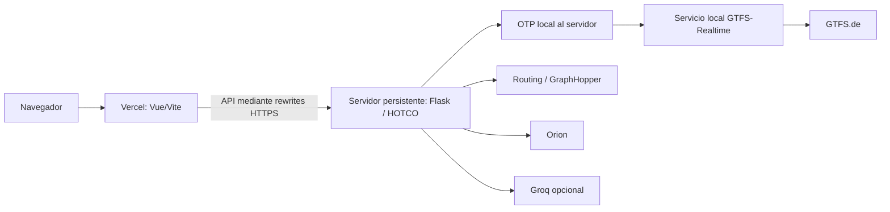

# Auditoría de recursos y preparación para Vercel

Fecha: 9 de octubre de 2026. Rama inspeccionada: `android-compose`. «Vergel» se interpreta como Vercel. Alcance: inventario y evaluación de la versión web existente; no se eliminan fuentes ni se publica la aplicación.

## Resultado

El frontend Vue/Vite compila y puede alojarse en Vercel. El repositorio todavía no está preparado para ofrecer todas sus funciones en producción: faltan el encaminamiento de API, un backend accesible y una ubicación persistente para OTP y su actualizador de tiempo real.

Publicar la interfaz por sí sola no publica HOTCO, Orion, Groq ni los horarios. Tampoco transforma las funciones nativas Android en funciones web. La limpieza de recursos y la preparación funcional son trabajos distintos.

La arquitectura propuesta para mantener el transporte actual es:



Mantener Flask, OTP y el actualizador en un mismo servidor conserva el requisito loopback del cliente OTP. El servidor público debe ser HTTPS, permanecer operativo sin el PC de desarrollo y tener configuradas sus dependencias. Es una propuesta de despliegue, no infraestructura ya creada.

## Evidencia y método

- Compilación real de Vite con `write:false`: 157 módulos transformados, 116 entradas locales resueltas, 33 salidas y 18.283.476 bytes de bundle. La salida medida no incluye los archivos copiados desde `public/`. La carpeta `dist/` existente pesa 18.303.041 bytes; no es un límite de descarga inicial, pues hay recursos y páginas cargados por separado.
- Inventario del sistema de archivos con clasificación, tamaño y estado en Git. Los directorios generados se agregan; `.git/`, `.local-backups/`, `.idea/` y `output/` se registran sin examinar sus contenidos.
- Cierre transitivo de imports Python desde `main.py`: 45 módulos locales y tres archivos de datos necesarios. No se encontraron módulos Python de runtime fuera de este cierre en el nivel principal de `dyconet`.
- Prueba en una copia mínima de 49 archivos, conservando el árbol relativo: import del backend y `/health`, contrato de viajes, estado de narración y rechazos de entradas inválidas correctos. Sin `.env` copiado y con `urlopen` bloqueado. Usa las dependencias Python instaladas localmente; no prueba una instalación limpia en Linux.
- No se realizaron despliegue, publicación, llamadas de narración facturables ni pruebas de carga. No se verificó la disponibilidad en producción de proveedores externos.

Resultados reproducibles: [inventario CSV](vercel-audit/inventory.csv), [resumen](vercel-audit/inventory-summary.json), [grafo Vite](vercel-audit/frontend-build-graph.json), [prueba de paquete backend](vercel-audit/backend-runtime-smoke.json).

## Qué no necesita el despliegue web

Excluir de la subida de fuentes o del bundle de ejecución no equivale a borrar del repositorio.

| Ruta o recurso | Decisión | Razón y condición |
|---|---|---|
| `android-native/` | Fuera del despliegue web | App Kotlin/Compose, Gradle, recursos y pruebas Android. Conservar para el móvil. |
| `experimental-frontend/android/` | Fuera del despliegue web | Empaquetado Capacitor anterior; no interviene en `npm run build`. |
| `experimental-frontend/capacitor.config.json` | Fuera del despliegue web | Configuración de empaquetado Android. |
| `experimental-frontend/scripts/build-android.mjs` | Fuera del despliegue web | Herramienta de compilación Android. |
| `node_modules/` | Fuera de la subida de fuentes | Regenerar con el lockfile. Las dependencias necesarias sí se instalan durante el build. |
| `dist/` local | Fuera de la subida de fuentes | Vercel debe generarlo. El `dist/` generado es precisamente el resultado que se sirve. |
| `build/`, `.gradle/`, `.venv/`, `venv/`, `__pycache__/`, `.pytest_cache/` | Fuera del despliegue | Compilaciones, herramientas, caches y entornos locales. |
| `*.log`, incluidos logs OTP/Vite/backend | Fuera del despliegue | Diagnóstico de sesiones locales; no son recursos de la app. |
| `.idea/`, `.git/` | Fuera del paquete de runtime | Metadatos locales o del control de versiones. Mantener Git para publicar el código. |
| `.local-backups/`, `output/` | Fuera de la subida y de `public/` | Copias, inspecciones y artefactos locales. No se inspeccionaron para este informe. |
| `validation/`, tests y fixtures | Fuera del runtime | Conservar para ejecutar comprobaciones; no servir datos de prueba al navegador. |
| `docs/`, `README.md`, `PLAN_IMPLEMENTACION_HOTCO.txt` | Fuera del runtime | Documentación útil en el repositorio. |
| `.env`, `.env.local`, claves y configuración privada | Fuera del despliegue de archivos | Configurar sus valores en el entorno de producción. No se leyeron contenidos privados. |
| `app-backend/`, `contracts/` | Fuera de la subida **del frontend separado** | Necesarios en el despliegue del backend; no son prescindibles del sistema completo. |

Volumen medido: aproximadamente 703,4 MB de directorios generados y 125,5 MB adicionales de fuentes/recursos Android. Son tamaños locales, no el tamaño del bundle web ni un cálculo de espacio que deba borrarse. Copias privadas no están incluidas en esos totales.

## Archivos candidatos a retirada

`experimental-frontend/src/services/compactLayout.js` — 353 bytes. No aparece en el grafo de compilación y la búsqueda de referencias no encontró consumidores. Puede retirarse en una limpieza posterior, verificando de nuevo el build. Ahorro de bundle actual: ninguno; Vite ya no lo incluye.

No se propone retirar módulos Python del runtime: todos los 45 módulos del nivel principal son alcanzables desde `main.py`, incluso los utilizados por endpoints opcionales o por imports condicionales. El análisis estático es conservador y no sustituye pruebas de cada endpoint.

No retirar las imágenes de `src/vendor/leaflet/images/`: las referencias CSS `url(...)` y las URLs de iconos construidas por Leaflet pueden no aparecer como módulos JavaScript. Se conservan las cinco imágenes y la licencia. Tampoco retirar narraciones antiguas o catálogos `legacy` sin comprobar la compatibilidad con historias guardadas.

## Archivos que sí hay que conservar

### Frontend

- `experimental-frontend/index.html`, `package.json`, `package-lock.json` y `vite.config.js`.
- `experimental-frontend/src/`, incluido arte, componentes, estilos, stores, servicios y JSON de narración. El inventario enumera cada entrada resuelta.
- `public/favicon.svg` y `public/branding/imiq-ovgu-logo.png`: el HTML y la pantalla de carga los solicitan por URL.
- Licencias y atribuciones de Leaflet, OpenStreetMap y fuentes. La licencia de la fuente instalada viene de sus dependencias; las licencias de recursos locales deben conservarse.

Aunque algunas rutas solo se ejecuten en Android, el build web actual importa `@capacitor/core` y resuelve imports dinámicos de App, Geolocation, Filesystem y Share. No eliminar esos paquetes sin separar primero la implementación nativa de la web y regenerar el lockfile. `@capacitor/android` y CLI sirven al empaquetado Android, pero quitarlos del proyecto compartido rompería esos comandos.

Las doce hojas PNG utilizadas son recursos reales de los compañeros, no sobrantes. La mayor parte del peso web procede de esos recursos. Optimizar formatos o carga es un trabajo adicional; borrar variantes visibles eliminaría funciones.

### Backend

- Los 45 módulos enumerados en `inventory-summary.json` y `requirements.txt`.
- `app-backend/services/dyconet/artifacts/adaptive_passport_v1.json`: modelo inicial cargado en runtime; no es un artefacto desechable.
- `app-backend/services/dyconet/choice_wording_v1.json`: catálogo requerido por Groq y el fallback.
- `contracts/journey-v1.schema.json`: cargado al importar `journey_contract.py` mediante `Path(__file__).resolve().parents[3]`. Conservar el árbol relativo o adaptar explícitamente esa resolución antes de separar el backend en otra raíz de despliegue.

## Bloqueos antes de publicar

| Prioridad | Hallazgo concreto | Trabajo necesario |
|---|---|---|
| P0 | `/api/dyconet` solo tiene proxy en el servidor de desarrollo de Vite. No existe configuración Vercel activa. | Añadir rewrites de producción o adaptar transporte web con CORS. Mapear `/api/dyconet/health` a `/health`. |
| P0 | En web, `apiFetch` hace `fetch(path)` y no utiliza `backendBase()`. | No asumir que `VITE_BACKEND_BASE_URL` o el menú Connection cambian el backend del navegador. El menú configura el transporte nativo; corregir su presentación web o explicar el encaminamiento fijo. |
| P0 | OTP y el monitor se encuentran en `127.0.0.1:8091/8092` del equipo de desarrollo. `otp_transit.local_url` solo permite HTTP loopback. | Hospedar Flask y ambos servicios de transporte juntos en un servidor persistente. Cambiar solo las variables a un dominio remoto no funciona con la validación actual. |
| P0 | El proyecto externo `Cricket-OTP-Probe` no está incluido en Cricket. | Preparar su despliegue separado con `rt_proxy.py`, OTP/JDK, grafo, GTFS filtrado, manifest y configuraciones. Definir actualización del GTFS estático y reconstrucción del grafo para no agotar su calendario de servicio. |
| P0 | Seis archivos requeridos están sin seguimiento en Git. | Incluirlos en un commit antes del despliegue desde Git; la copia local ya los usa. |
| P1 | Funciones actuales de Android no tienen equivalencia completa en Vue. | Definir si se publica la web existente o se requiere paridad; implementar tracking/experiencia web por separado cuando corresponda. |
| P1 | Respuestas de deliberación contienen evidencia, geometría y diagnósticos; validación de viaje permite hasta 8 MiB. | Medir tamaños y latencias reales de producción. Si se elige Flask en Vercel, atender los límites de payload y duración; no asumir que un build correcto los satisface. |
| P1 | Proveedores de routing, Orion, Photon, teselas y Groq son externos. | Configurar URLs, credenciales y realizar pruebas reales desde el servidor de producción. Photon público y teselas no se convierten en servicios propios al desplegar. |
| P1 | No hay cuenta/sincronización central del historial en el flujo actual. | El Passport y el historial web siguen en localStorage/IndexedDB del origen. Exportar/importar para migrar datos al nuevo dominio; una URL nueva no recibe los datos del móvil automáticamente. |

Archivos requeridos sin seguimiento al auditar:

```text
app-backend/services/dyconet/journey_api.py
app-backend/services/dyconet/journey_contract.py
app-backend/services/dyconet/recommendation_robustness.py
app-backend/services/dyconet/response_transport.py
app-backend/services/dyconet/weather_api.py
contracts/journey-v1.schema.json
```

También hay cambios locales en archivos ya versionados. Esta auditoría no los incorpora a Git, no decide qué cambios ajenos publicar y no confirma que estén subidos al remoto.

## Alcance de «completamente operativa»

La web existente puede ofrecer onboarding, pasaporte, búsquedas, mapas, horarios/retrasos, explicaciones y almacenamiento/exportación local cuando sus servicios estén disponibles.

La implementación Android añade tracking foreground, recuperación de interrupciones, contratos de viaje y feedback específico. `src/services/journeyExperience.js` de la web guarda la elección y lugares recientes; no equivale a `TrackingEngine.kt` ni al flujo `TripUi.kt`. Alojar Vue en HTTPS permite geolocalización del navegador con permiso, pero no reproduce por sí solo el servicio Android de tracking ni su funcionamiento en segundo plano.

El aprendizaje bayesiano, CO2e y la retirada de F3 siguen pendientes en el plan científico. No son funciones que puedan habilitarse únicamente mediante configuración de hosting.

## Despliegue recomendado y alternativa

**Opción recomendada para el estado actual:** Vercel sirve el frontend y hace rewrites HTTPS a un backend persistente. El backend mantiene HOTCO, OTP y el servicio GTFS-Realtime. Esto evita adaptar el cliente OTP para conectarlo a un host remoto y permite mantener su actualización de fondo.

Configuración propuesta del proyecto frontend:

```text
Root Directory: experimental-frontend
Framework: Vite
Install Command: npm ci
Build Command: npm run build
Output Directory: dist
```

Se entregan ejemplos inactivos de `vercel.json` y `.vercelignore` en `docs/vercel-audit/`. El dominio `backend.example.invalid` debe reemplazarse por el backend real. No se copian todavía a la raíz activa ni se publica nada. Priorizar rewrites de API antes de cualquier fallback HTML. El frontend actual navega principalmente por estado/query; el fallback no sustituye el proxy de API.

**Alternativa:** Vercel admite Flask/Python como Function. No basta con seleccionar la carpeta del frontend: hay que preparar un entrypoint reconocido y garantizar los imports y datos del backend. `main.py` con imports hermanos necesita una resolución explícita de módulo o un adaptador. Una Function Python no despliega automáticamente el proceso Java de OTP ni su actualizador persistente. Con el cliente OTP actual, separar Flask de OTP requiere rediseñar ese acceso de servidor, por ejemplo un gateway seguro y un cliente compatible. No exponer `8091/8092` directamente al navegador.

Las dependencias `gunicorn` son pertinentes en un servidor WSGI persistente; Vercel gestiona su propio runtime de Flask. No quitarlas del requirements compartido sin definir primero cuál es el despliegue del backend.

No se recomienda asumir un límite antiguo fijo de tamaño del bundle Python: Vercel anunció Large Functions en beta, hasta 5 GB con Fluid Compute, el 29 de junio de 2026. La elegibilidad y los límites efectivos deben verificarse en el proyecto. Eso no convierte una Function en un servidor persistente de OTP.

## Criterios de aceptación

Antes de llamar operativa a la publicación:

1. Abrir el sitio en un navegador sin acceso al PC local; verificar favicon, logo, fuentes, compañeros y mapas.
2. Confirmar `/api/dyconet/health` devuelve JSON y la versión de modelo; ninguna ruta API debe devolver `index.html` por error.
3. Crear y confirmar un Passport; buscar alternativas reales para todos los modos habilitados.
4. Verificar OTP, conexión programada y, cuando exista, retraso real; comprobar fallback si el feed envejece.
5. Verificar Orion y sus estados de información ausente; Groq o fallback determinista correctamente identificado.
6. Elegir, guardar, reabrir historial, exportar/importar una copia y comprobar el nuevo origen de almacenamiento.
7. Medir latencia, tamaño de requests/responses y comportamiento con búsquedas largas; los cinco checks locales no sustituyen estas pruebas.
8. Si se exige paridad Android, validar aparte el flujo de viaje/experiencia y las limitaciones de tracking del navegador.

## Documentación oficial consultada

- [Vite en Vercel](https://vercel.com/docs/frameworks/frontend/vite): compilación, salida y configuración SPA.
- [Rewrites](https://vercel.com/docs/routing/rewrites): encaminamiento a un backend externo.
- [Flask en Vercel](https://vercel.com/docs/frameworks/backend/flask): aplicación WSGI como Function y entrypoints.
- [Runtime Python](https://vercel.com/docs/functions/runtimes/python): empaquetado y exclusiones; no hay eliminación automática de dependencias Python no usadas.
- [Límites de Functions](https://vercel.com/docs/functions/limitations): payload de request/response documentado de 4,5 MB, duración y memoria. Contrastar con la configuración efectiva al implementar la alternativa serverless.
- [Large Functions](https://vercel.com/changelog/vercel-functions-can-now-be-up-to-5-gb-in-package-size): anuncio de beta hasta 5 GB para Node/Python con Fluid Compute.

La elección de arquitectura es una recomendación de esta auditoría basada en el código inspeccionado, no una garantía de hosting ni una validación científica de HOTCO.
